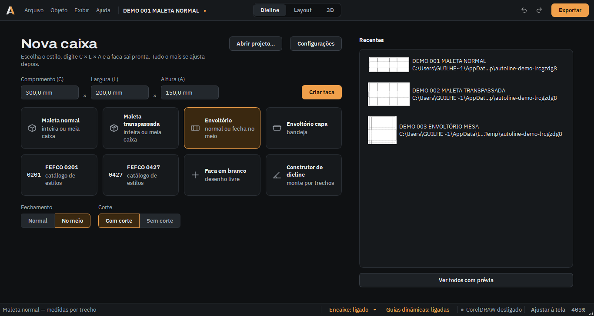
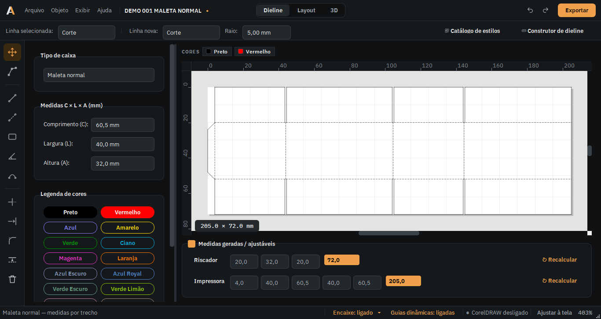
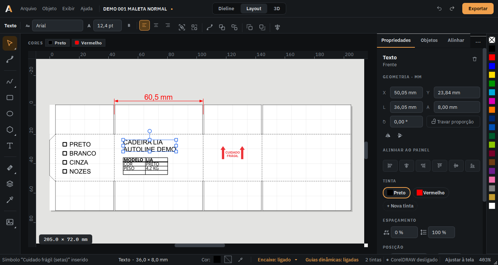
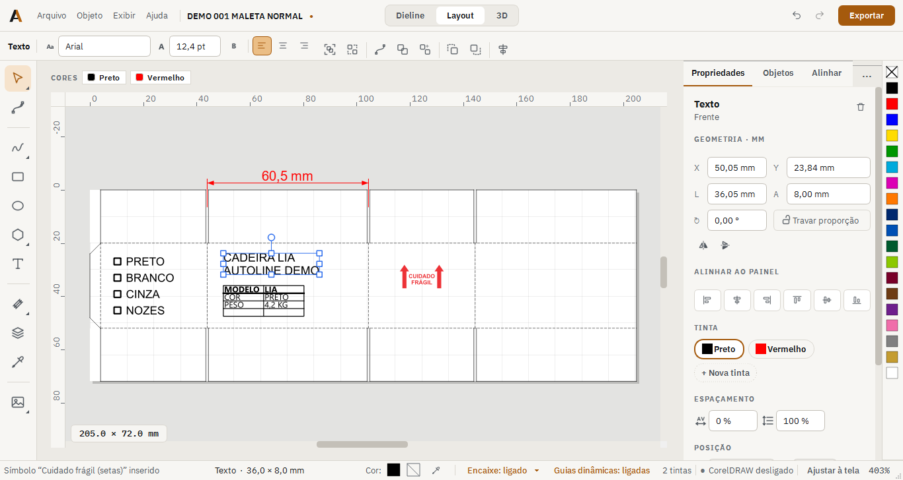
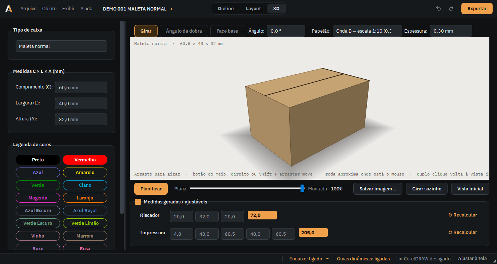
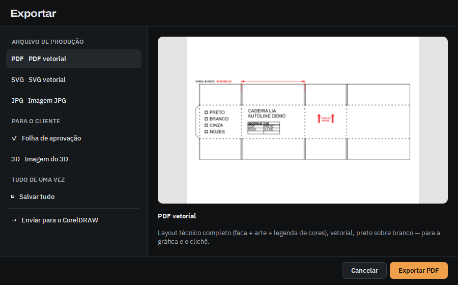
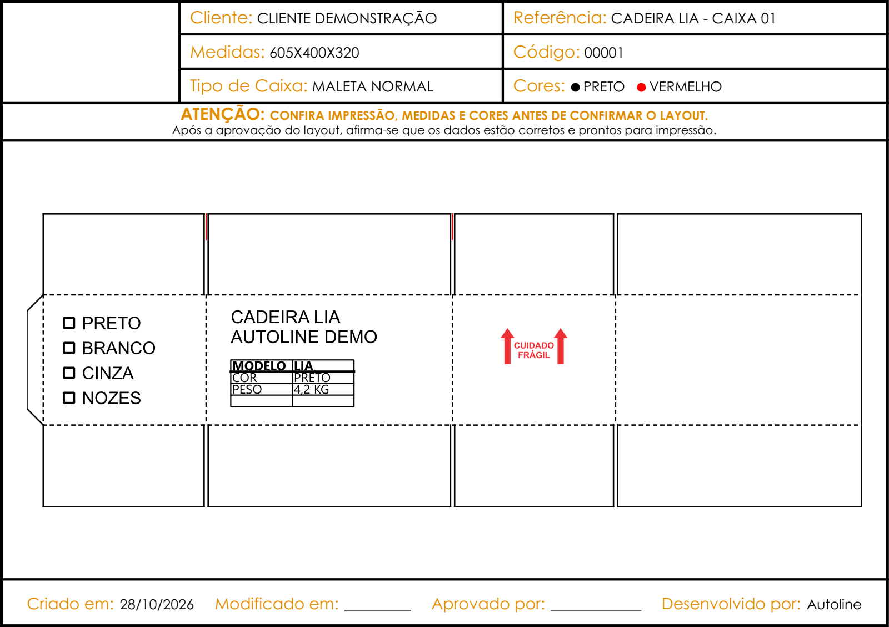
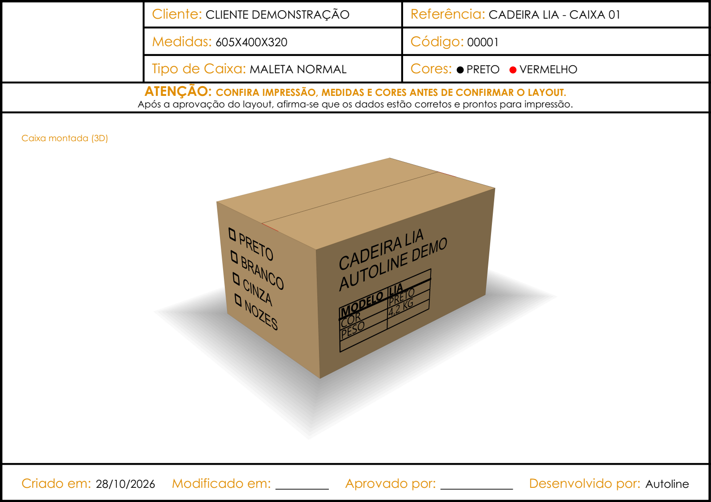

# Autoline

Aplicativo desktop (Python + PySide6, Windows) que gera a faca técnica
(dieline) de caixas de papelão ondulado, monta a arte sobre ela, mostra a
caixa montada em 3D e tira os arquivos que vão para o cliente e para a
produção: JPG, SVG, PDF, a folha de aprovação e o envio ao CorelDRAW.

É a reescrita, em Python, de um sistema feito em C#/.NET que desenhava as
linhas no CorelDRAW por automação COM. O cálculo das medidas foi portado
1:1 (ver `tests/`), e hoje todo o trabalho acontece dentro do próprio
Autoline. O CorelDRAW virou opcional.

## O que o Autoline faz

**Início**
- Nova caixa: C × L × A, o estilo e as variantes dele (inteira ou meia
  caixa, fechamento normal ou no meio, com ou sem corte) e **Criar faca**.
- Recentes com miniatura, catálogo FEFCO, faca em branco e construtor de
  dieline.

**Dieline (faca)**
- 9 tipos prontos:
  - maleta normal e maleta transpassada, cada uma inteira ou meia caixa;
  - envoltório, com fechamento normal ou no meio e com ou sem corte;
  - envoltório capa (bandeja).
- Trechos da impressora (colunas) e do riscador (linhas) automáticos ou
  digitados à mão.
- Faca editável (F10) com ferramentas no estilo ArtiosCAD: retângulo,
  linha por medida, arco, paralela, aparar, estender e arredondar.
- Guias dinâmicas e encaixe com o nome do ponto.
- Estilos paramétricos (FEFCO 0201 e 0427, mais os meus) e construtor de
  dieline por trechos.

**Layout (arte sobre a faca)**
- Ferramentas e atalhos do CorelDRAW: caixa de ferramentas com flyouts e
  "Ajustar a".
- Formas, curvas Bézier e mão livre (Forma F10), cotas (paralela,
  horizontal, vertical, angular), callout, acabamento, imagem e logotipo
  vetorial com separação de cor.
- Modelar: Soldar, Aparar, Interseção.
- Texto, checklist de cores e tabela no padrão da máquina: Arial Black,
  letra de 2 mm, 66,7% de largura.
- Banco de simbologias (manuseio, transporte, "cuidado frágil") no tamanho
  real.
- 19 tintas de impressão mais tintas próprias, com legenda de cores,
  paleta e conta-gotas.
- Inspetor à direita: Propriedades, Objetos, Alinhar, Transformações e
  Simbologias.
- Zonas seguras (recuo do vinco), malha e medidas até a borda de cada face.
- Desfazer e refazer completos, inclusive em grupos.

**3D**
- A caixa montada com a arte, com dobra animada, giro, zoom e lupa.
- Qualquer faca dobra: ângulo por vinco e face base.
- Espessura e ondas do papelão, inclusive em escala 1:10, e cor do
  papelão configurável.
- Foto da vista em JPG ou PNG.

**Projeto e saídas**
- Arquivo de projeto `.autoline`, com recuperação automática a cada
  2 minutos e miniatura no Explorer.
- Exportar:
  - JPG do layout, sempre quadrado;
  - SVG e PDF vetoriais;
  - **Salvar e exportar tudo** num clique (Ctrl+Shift+E);
  - envio ao CorelDRAW.
- Folha de aprovação em PDF (A4 deitado): medida real e foto 3D nítida
  na 2ª folha.
- Aviso quando o arquivo de destino está aberto em outro programa.

**Interface**
- Tema escuro e tema claro, com seletor Dieline | Layout | 3D na barra de
  título.
- Cabe numa tela de 1366 px.
- Manual de uso em Ajuda > Manual de uso.

As caixas são desenhadas em **escala 1:10**: uma caixa de 605 mm é
desenhada com 60,5 mm. A folha de aprovação mostra a medida real.

## Telas

Prints em 1366 px com um projeto de demonstração: maleta normal
605 × 400 × 320 mm, desenhada em 1:10.

**Início.** Estilo, variantes e C × L × A, mais os recentes com miniatura.



**Dieline.** A faca, a legenda de cores e os trechos da impressora e do
riscador.



**Layout.** A arte por face, com o inspetor à direita: geometria,
alinhar ao painel, tinta e espaçamento.





**3D.** A caixa montada com a arte e o papelão na escala 1:10.



**Exportar.** Arquivos de produção, saídas para o cliente e "Salvar tudo".



**Folha de aprovação** (PDF A4). Na página 1, a faca com a arte; na
página 2, o 3D.





## Rodando localmente

<!-- AUTO-GENERATED: requirements*.txt, app.py, Autoline.spec -->
| Comando | O que faz |
|---|---|
| `python -m venv .venv` e `.venv\Scripts\pip install -r requirements-dev.txt` | Cria o ambiente com PySide6, pywin32 e pytest |
| `$env:PYTHONPATH="src"; .venv\Scripts\python -m gerador_layout.main` | Abre o app a partir do código (PowerShell; no Git Bash: `PYTHONPATH=src .venv/Scripts/python -m gerador_layout.main`) |
| `.venv\Scripts\python -m pytest -q tests` | Roda os testes (offscreen; o `tests/conftest.py` já põe `src` no caminho) |
| `.venv\Scripts\pip install -r requirements-build.txt` | Instala o PyInstaller (e o Pillow, só para gerar o ícone) |
| `.venv\Scripts\pyinstaller --noconfirm --clean Autoline.spec` | Gera `dist\Autoline.exe` (com o app fechado) |
| `miniatura_explorer\compilar.bat` | Compila a DLL da miniatura do `.autoline` no Explorer |
<!-- /AUTO-GENERATED -->

O `app.py` só existe para o PyInstaller ter um script de entrada. No dia
a dia, use `python -m gerador_layout.main`.

## Estrutura

<!-- AUTO-GENERATED: src/gerador_layout (main 7c15990) -->
```
src/gerador_layout/
├── models.py              # TipoCaixa, MedidasCaixa, LinhaDesenho, CorImpressao, LayoutCaixa
├── layout_service.py      # cálculo das linhas da faca por tipo de caixa
├── paineis.py             # faces da caixa aberta (onde cada arte "mora")
├── dobra3d.py             # dieline plana → caixa montada (tipos prontos)
├── dobra_generica.py      # dobra 3D de qualquer faca (estilo ArtiosCAD)
├── geometria_faca.py      # retas, arcos e ferramentas de desenho da faca
├── estilos.py             # estilos paramétricos (expressões via ast, sem eval)
├── estilos_catalogo.py    # FEFCO 0201 e 0427
├── construtor_dieline.py  # faca montada por trechos
├── simbologias.py         # banco de símbolos (SVG no tamanho real)
├── svg_corel.py           # correção dos SVGs exportados pelo CorelDRAW
├── main.py                # ponto de entrada
└── ui/
    ├── main_window.py     # JanelaPrincipal: telas, menus, inspetor, trocas de tela
    ├── tela_inicio.py     # tela de Início
    ├── moldura.py         # barra de título e barra de status
    ├── preview_canvas.py  # canvas 2D: ferramentas, encaixe, faca editável, desfazer
    ├── mockup_*.py        # um módulo por tipo de objeto do Layout
    ├── painel_propriedades_mockup.py  # linha de contexto + aba Propriedades
    ├── dockers_corel.py   # Objetos, Alinhar e distribuir, Transformações
    ├── visualizacao_3d.py # vista 3D em QPainter (textura por face, foto)
    ├── bsp3d.py           # ordem de pintura exata do 3D
    ├── projeto_arquivo.py # arquivo .autoline
    ├── exportacao.py      # JPG / SVG / PDF
    ├── folha_aprovacao.py # PDF da folha de aprovação
    ├── corel_bridge.py    # automação COM com o CorelDRAW (só Windows)
    ├── estilo.py          # temas (tokens) e folha de estilo QSS
    └── dialogo_*.py       # Configurações, Exportar, estilos, construtor, manual...
tests/                     # pytest, um arquivo por área
capturas/                  # prints das telas usados neste README
miniatura_explorer/        # miniatura do .autoline no Explorer (C#)
assets/                    # ícone e fontes (Archivo, IBM Plex)
```
<!-- /AUTO-GENERATED -->

## Regras do domínio

- Estrutura da **maleta normal**:
  - Impressora, esquerda → direita: `Aba × L × C × L × C`
  - Riscador, cima → baixo: `(L/2) × A × (L/2)`
- Exemplo para caixa **300 × 200 × 150**:
  - Impressora: `4 × 200 × 300 × 200 × 300`
  - Riscador: `100 × 150 × 100`
- **Meia caixa**: só `Aba × L × C` na impressora (caixa grande feita em
  duas metades coladas depois). No 3D ela aparece inteira.
- As "medidas geradas/ajustáveis" podem ser alteradas manualmente sem
  alterar as medidas finais **C × L × A** da caixa. Zerar um trecho volta
  ao valor automático.

## Documentação

- `PRODUCT.md`: para quem é e por quê.
- `DESIGN.md`: o sistema visual (cores, tipografia, componentes).
- `REFERENCIA_CORELDRAW.md`, `REFERENCIA_ARTIOSCAD_ESTRUTURA.md` e
  `REFERENCIA_FERRAMENTAS_ARTIOSCAD.md`: estudos de sala limpa e o plano de
  cada etapa.
- O cofre Obsidian local, em `docs/`, não vai para o repositório. Ele
  guarda:
  - o **Guia do Autoline**, tela por tela, com todos os prints, inclusive
    diálogos, Configurações, catálogo de estilos e construtor;
  - as notas de funcionalidades, bugs e decisões;
  - o mapa do código.

## Licença

Ver [LICENSE](LICENSE).
